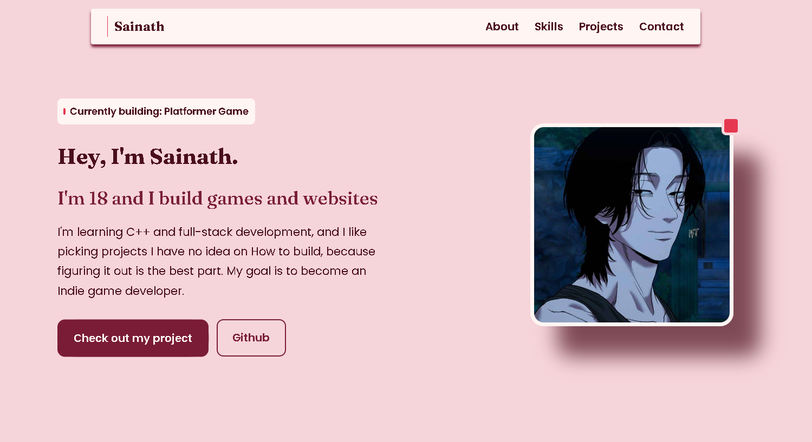

## Sainath's Builder Page

A personal portfolio website which describes me, the skills i have and the projects i made.

**Live:** https://my-builder-page.vercel.app



## Whats on it

- **Hero:** Who I am, what I'm building rn and a button that throws bubbles when you hover it.
 **About:** A bento grid with the short version of m : where I'm from, what im learning and what I want to do.
- **Skills:** everything I've actually used, grouped by Game Dev, Languages, Web and Tools.
- **Projects:** All the projects i have made up till now and soon to come.
- **Footer:** the place where u can find me.

## Built with 
- React + Vite
- Plain CSS
- GSAP
- Fraunces and poppins for fonts
- Deployed on Vercel

## Run it yourself

```bash
git clone https://github.com/shiz1ee/My-Builder-Page.git
cd My-builder-page
npm run dev
```
